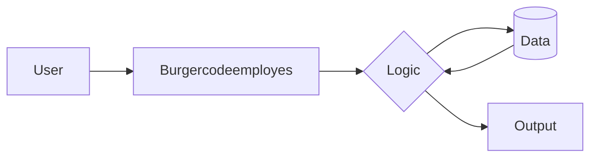

# 🍔 burgerCodeEmployes

> **A lightweight employee management API for burger restaurants.**
> Track shifts, hours, tips, and roles for fast-food staff. Built with FastAPI + SQLite.

## Architecture / How it Works




## About

`burgerCodeEmployes` is a tiny, self-contained REST API for managing employees at a burger joint — schedules, clock-in/out, role assignment (cashier, grill, fry, manager), and tip distribution. Designed to be dropped into a kiosk or used by an owner who wants their employee data on the LAN, no SaaS lock-in.

## Features

- **Employees** — CRUD for staff, role assignment (cashier / grill / fry / manager), hourly rate.
- **Shifts** — Clock-in / clock-out with auto-computed hours.
- **Tips** — Daily tip pool allocation by hours worked.
- **Reports** — Weekly hours + pay summary per employee.
- **SQLite** by default; swap in Postgres by changing one env var.

## Tags / Topics

`python` `fastapi` `restaurant` `employee-management` `shift-scheduling` `tips` `sqlite` `pydantic` `rest-api` `small-business`

## Quick start

```bash
git clone https://github.com/ALPHAMAN-0/burgerCodeEmployes.git
cd burgerCodeEmployes
python3 -m venv .venv && source .venv/bin/activate
pip install -r requirements.txt
uvicorn burgerCodeEmployes.app:app --reload
```

Open http://localhost:8000/docs for the interactive OpenAPI.

## Endpoints

| Method | Path                                | Description                |
|--------|-------------------------------------|----------------------------|
| POST   | `/employees`                        | Create an employee         |
| GET    | `/employees`                        | List employees             |
| GET    | `/employees/{id}`                   | Fetch one employee         |
| PATCH  | `/employees/{id}`                   | Update role / rate         |
| POST   | `/shifts/clock-in`                  | Clock in                   |
| POST   | `/shifts/clock-out`                 | Clock out                  |
| GET    | `/shifts?employee_id=X&date=YYYY-MM-DD` | List shifts             |
| POST   | `/tips/allocate`                    | Allocate tips for a day    |
| GET    | `/reports/weekly?employee_id=X`     | Weekly hours + pay summary |

## Data model

```
Employee(id, name, role, hourly_rate, active)
Shift(id, employee_id, clock_in, clock_out, hours)  # hours computed at clock-out
TipAllocation(id, date, total_pool, lines[employee_id, share])
```

## License

MIT.